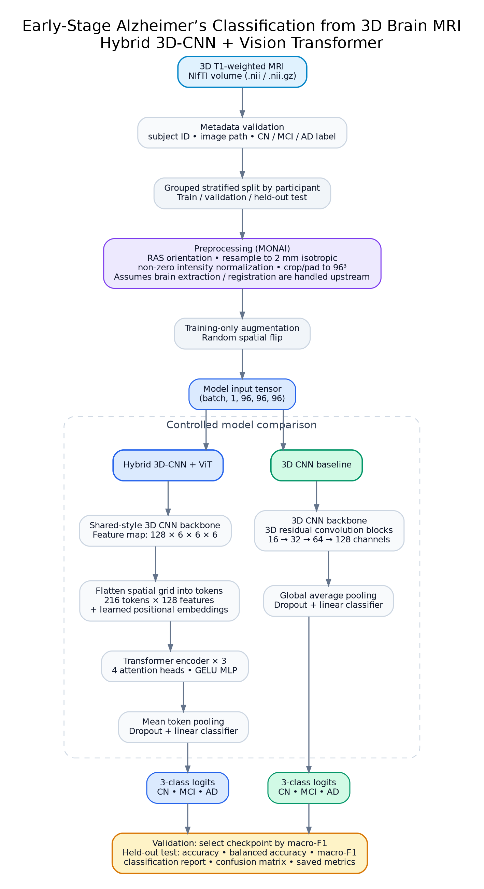

# Early-Stage Alzheimer’s Classification from 3D Brain MRI

### A hybrid 3D Convolutional Neural Network and Vision Transformer

This project implements a volumetric MRI classification pipeline that combines local anatomical feature extraction from a 3D CNN with long-range spatial modelling using a Vision Transformer (ViT). A 3D CNN baseline is included to make the contribution of Transformer-based attention measurable under the same data split and evaluation protocol.

The task is formulated as three-class classification using clinical labels: **Cognitively Normal (CN)**, **Mild Cognitive Impairment (MCI)**, and **Alzheimer’s Disease (AD)**. MCI is a clinical group and should not be treated as equivalent to an Alzheimer’s diagnosis.

> **Research status:** The implementation and experiment workflow are provided. This repository does not include clinical MRI data or claim benchmark results from a completed training run. The reported metrics, checkpoints, and plots are generated by running the notebook on real, correctly labelled data.

## Architecture




### Model components

| Component | Role |
|---|---|
| Volumetric MRI input | Loads a 3D T1-weighted brain MRI from a NIfTI file (`.nii` or `.nii.gz`). |
| Preprocessing | Standardizes orientation, resamples voxel spacing, normalizes non-zero intensities, and crops/pads the volume to `96 × 96 × 96`. |
| 3D CNN backbone | Uses 3D convolutional residual blocks to learn local features across width, height, and depth. The feature channels increase from 16 to 128. |
| Tokenization | Converts the CNN feature grid (`128 × 6 × 6 × 6`) into 216 tokens with 128 features each, and adds learned positional embeddings. |
| Transformer encoder | Applies three encoder layers with four attention heads to model relationships between spatially separated feature locations. |
| Classification head | Produces logits for CN, MCI, and AD. |
| CNN baseline | Uses the same 3D CNN backbone, followed by global average pooling and a linear classification head, without Transformer attention. |

The central hypothesis is that Transformer self-attention can complement local convolutional features by modelling relationships between distant anatomical regions. This is a hypothesis to test—not a guaranteed performance improvement.

## Pipeline

1. **Load and validate metadata.** Check subject identifiers, image paths, and labels; reject missing files or unsupported labels.
2. **Split by participant.** Create grouped, stratified training, validation, and held-out test splits. Scans from the same participant must not cross splits.
3. **Preprocess volumes.** Harmonize orientation to RAS, resample to 2 mm isotropic spacing, normalize non-zero intensities, and crop/pad to the configured input size. Apply random spatial flipping to training data only.
4. **Train comparable models.** Train the 3D CNN baseline and the hybrid 3D-CNN–ViT model with class-weighted cross-entropy and AdamW.
5. **Select checkpoints.** Use validation macro-F1 for checkpoint selection and early stopping. Do not use test performance to select epochs or hyperparameters.
6. **Evaluate once on held-out participants.** Generate accuracy, balanced accuracy, macro-F1, per-class metrics, classification reports, and confusion matrices.
7. **Save the run.** Export split manifests, model checkpoints, training histories, test metrics, plots, and an experiment record.

## Data requirements

The notebook expects one row per MRI scan in a metadata CSV with these columns:

| Column | Description |
|---|---|
| `subject_id` | Stable, de-identified participant identifier used for leakage-safe splitting. |
| `image_path` | Path to a 3D NIfTI volume, absolute or relative to `IMAGE_ROOT`. |
| `label` | One of `CN`, `MCI`, or `AD`, sourced from clinical metadata. |

Example schema only:

```csv
subject_id,image_path,label
participant_001,processed/participant_001_T1w.nii.gz,CN
participant_002,processed/participant_002_T1w.nii.gz,MCI
participant_003,processed/participant_003_T1w.nii.gz,AD
```

These example rows are placeholders, not real participants or dataset records. Replace them with records from data you are authorized to use. Do not infer diagnostic labels from filenames alone.

### Candidate datasets

- **ADNI:** [Official data access page](https://adni.loni.usc.edu/data-samples/adni-data/#AccessData). Access requires an application and compliance with the dataset’s use terms.
- **OASIS:** [OASIS brain imaging resources](https://sites.wustl.edu/oasisbrains/home/oasis-1/). Review the release documentation and clinical fields before deciding whether its labels support the intended CN/MCI/AD task.

The datasets are not interchangeable. Confirm diagnostic definitions, MRI acquisition type, repeated visits, subject identifiers, and licensing before preparing the metadata. If multiple scans per participant are present, choose and document a consistent scan-selection strategy.

### Preprocessing assumptions

The notebook handles orientation harmonization, resampling, non-zero intensity normalization, and fixed-size crop/pad. It assumes that **brain extraction and anatomical registration have already been performed or are supplied by a documented upstream workflow**. These operations should be verified visually; automatic crop/pad should not remove relevant anatomy. Apply the same deterministic preprocessing to validation and test scans. Use augmentation only on training data.

## Configuration

The principal starting settings are defined near the top of the notebook and can be changed for the available hardware and dataset.

| Setting | Default |
|---|---:|
| Target voxel spacing | `2.0 × 2.0 × 2.0 mm` |
| Model input | `1 × 96 × 96 × 96` |
| Batch size | `1` |
| Maximum epochs | `20` |
| Learning rate | `2e-4` |
| Weight decay | `1e-4` |
| Early-stopping patience | `5` epochs |
| Random seed | `42` |
| Transformer layers | `3` |
| Attention heads | `4` |

These are initial experimental settings, not a claim that they are optimal. Three-dimensional models can be memory-intensive; GPU memory, scan resolution, and dataset size may require tuning.

## Setup and execution

Use Python 3.10 or a compatible environment, Jupyter, and a PyTorch build appropriate for the operating system and CUDA driver. Install the project dependencies:

```bash
pip install -r requirements.txt
```

Open `early_alzheimers_3d_cnn_vit.ipynb`, update `METADATA_CSV` and `IMAGE_ROOT`, and run the cells in order. The default paths expect the metadata at `data/metadata.csv` and image paths relative to `data/`. GPU-enabled PyTorch should be installed separately using the [official PyTorch installation selector](https://pytorch.org/get-started/locally/).

## Outputs

After a successful run on real MRI data, the notebook writes artefacts to `outputs/`, including:

- `train_split.csv`, `validation_split.csv`, and `test_split.csv` — auditable split manifests;
- best-validation checkpoints for the 3D CNN and hybrid model;
- training history and loss/metric curves;
- held-out test metrics in `test_metrics.csv`;
- classification reports and confusion matrices;
- `experiment_record.json` — key configuration, device, software versions, split sizes, and results location.

The test set should remain untouched during model selection. Numerical results should be reported only from the outputs of a completed run; a random-tensor shape check only verifies tensor dimensions and is not an experiment.

## Evaluation protocol

Accuracy alone can hide poor performance on underrepresented diagnostic classes. Report accuracy alongside balanced accuracy, macro-F1, per-class precision/recall, and confusion matrices. When appropriate, also report one-vs-rest ROC-AUC and confidence intervals. Compare the baseline and hybrid model on identical splits, and ideally repeat experiments across multiple random seeds or subject-level cross-validation folds. External-cohort evaluation is needed to assess generalization across acquisition sites and populations.

## Repository structure

```text
alz_3d_cnn_vit_project/
├── early_alzheimers_3d_cnn_vit.ipynb   # End-to-end modeling and evaluation workflow
├── metadata_template.csv               # Empty input metadata template
├── requirements.txt                    # Python dependencies
├── build_notebook.py                   # Notebook-generation utility
├── README.md                           # Project and reproduction guide
└── docs/
    ├── architecture.png                # Architecture diagram
    ├── architecture.svg                # Scalable diagram
    └── architecture.dot                # Editable Graphviz source
```

## Limitations and responsible use

- The outputs depend on the cohort, labels, preprocessing decisions, and training configuration; performance must be measured on the actual selected dataset.
- Scanner/site effects, demographic confounding, repeated subjects, duplicates, and label imbalance can inflate apparent performance or impair generalization.
- One split and one random seed provide limited evidence. Strong conclusions require repeated evaluation and external validation.
- This is a research classification pipeline, not a clinically validated diagnostic system. It must not be used to make medical decisions.

## Citation and attribution

Cite the data source, relevant preprocessing tools, and methodological papers used in any public report. Follow the selected dataset’s access, attribution, and redistribution requirements. Do not redistribute MRI scans unless the dataset license explicitly permits it.
